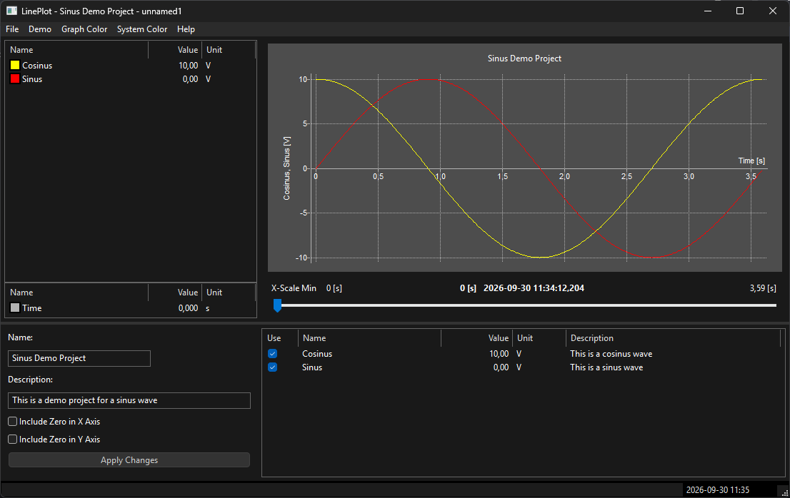

# 2D Plot Library for wxWidgets

Simple 2D plot library using wxWidgets.   

It uses the APlot library and/or the wxMathPlot library for the plotting. 
The library consists of five basic displays.

- The **Project** object that defines the signals and its X/Y-values.
- The **Plot Display** that plots the selected signal values.
- The **Legend Display** that shows the plot legends.
- The **Master Display** that shows the X-value.
- The **Alpha Numeric Display** shows all selected and not selected signals.
- The **Project Display** shows the main configuration.

The end-user can either use the predefined layouts or define its own layout(s).

### Project Object

The Project object is the main object that holds the signal definitions, 
and their X/Y values. Then end-user should mainly use this interface.
The other displays simply show the data values in the Project object.

### Plot Display

The display plots the selected signals. 
Note that only four Y-axis and one X-axis can be shown.
In general, no more than four signals should be plotted at the same time.

The display uses predefined color schemes, and by default it uses the system color mode.
The color scheme also defines the line color and its line style.

### The Legend Display
 
The display is a simple alphanumeric list that shows the selected signal values.
The current x-value defines what signal value to show. 
The Master Display defines the current x-value.

### The Master Display

The displays show the current x-value. 
It normally shows relative time but can also show the absolute time.
The user may change the current value.

### The Alpha Numeric Display

The display shows all signals. 
The user can select the signals to plot.

### The Project Display

The display shows the main project configuration.

### Layouts

A layout is a combination of displays.
The library predefines some layout, but it’s also possible to 
do this outside of the library. 

## Status of the Repository

The repository is a prototype. 
The current status is that the library is functional and can be used.

## License

The library is licensed under the MIT license.

